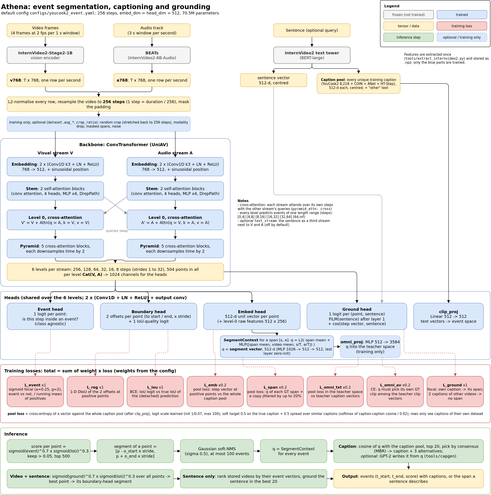

# Athena Retriever: event segmentation, captioning and grounding

Finds the steps (events) of a video, describes each one, and finds the span a sentence describes. Built on the
backbone of [UniAV](https://arxiv.org/abs/2404.03179) (audio-visual ConvTransformer, itself based on ActionFormer),
with no classification layer: events are class agnostic and are named by captions.

| Input | Output |
|---|---|
| a video | its events `(t_start, t_end, score)`, each with a caption |
| a video + a sentence | the span of the video the sentence describes |
| a sentence | the best matching stored videos and the span in each |

## Architecture



Editable diagram: [`docs/architecture.drawio`](docs/architecture.drawio) (open it in draw.io / diagrams.net).
Every size, layer and formula in detail: [`docs/ARCHITECTURE.md`](docs/ARCHITECTURE.md).

1. **Frozen features.** InternVideo2-1B gives a 768-d visual vector per second (`v768`), BEATs a 768-d audio vector
   per second (`a768`), the InternVideo2 text tower a 512-d vector per sentence. They are extracted once
   (`tools/extract_internvideo2.py`); nothing of these encoders is trained.
2. **Grid.** Every row is L2-normalised and the video is resampled to **256 steps**, whatever its length: one step is
   `duration / 256` seconds.
3. **Backbone** (trained, 70.5M parameters with the heads). One ConvTransformer per stream (V, A): embedding convs,
   2 self-attention blocks, then cross-attention blocks in which each stream attends over its own steps with the other
   stream's queries. The pyramid has 6 levels (256 down to 8 steps, 504 points); at each level V and A are concatenated
   (1024 channels). Each level predicts events of one length range.
4. **Heads**, shared over the levels:
   - **event**: one logit per point, "is this step inside an event";
   - **boundary**: distances from the point to the event's start and end, plus an IoU-quality logit for ranking;
   - **embed**: a 512-d vector per point in the caption space;
   - **ground**: one logit per (point, sentence), the event head conditioned on the sentence (FiLM).
5. **Segment vector** `q` of a span: mean of the embed features over the span, corrected by a small MLP that also
   sees the whole-video mean and the span's position (`SegmentContext`). The caption is chosen by comparing `q` with
   the **caption pool**, every unique training caption as an InternVideo2 text vector (mapped by `clip_proj`).

## Training losses

$$\mathcal{L} = \mathcal{L}_{event} + 1\cdot\mathcal{L}_{reg} + 1\cdot\mathcal{L}_{iou} + 0.2\,\mathcal{L}_{emb}
+ 0.2\,\mathcal{L}_{span} + 0.2\,\mathcal{L}_{omni\_txt} + 0.2\,\mathcal{L}_{omni\_av} + 1\cdot\mathcal{L}_{ground}$$

Weights are `model.train_cfg.loss_weight_*` in the config. Code: `losses()` in `libs/modeling/event_archs.py`,
focal and DIoU in `libs/modeling/losses.py`.

**Which points are positive.** A pyramid point is positive for a ground-truth event when its centre lies inside the
event and the event's length fits the point's level (ranges in steps: `[0,4] [4,8] [8,16] [16,32] [32,64] [64,inf)`).
Its targets are the distances to the event's start and end, in units of the level's stride.

| Loss | Applied to | Definition |
|---|---|---|
| $\mathcal{L}_{event}$ | every valid point | sigmoid focal loss, event vs not: $-\alpha_t(1-p_t)^{\gamma}\log p_t$ with $\alpha = 0.25$, $\gamma = 2$, summed and divided by $\bar N_{pos}$, a running mean (momentum 0.9) of the number of positive points per batch |
| $\mathcal{L}_{reg}$ | positive points | 1-D Distance-IoU of the predicted offsets $(l, r)$ against the targets $(l^{\ast}, r^{\ast})$: $1 - \mathrm{IoU} + (\rho / c)^2$, $\rho$ = distance between the two centres, $c$ = length of the smallest span covering both; summed, divided by $\bar N_{pos}$ |
| $\mathcal{L}_{iou}$ | positive points | binary cross-entropy of the IoU-quality logit against the true IoU of the (detached) predicted segment: the head learns how good its own boundaries are |
| $\mathcal{L}_{emb}$ | positive points (up to 1024 per batch) | pool loss (below) of each point's embed vector, target = the caption of its event |
| $\mathcal{L}_{span}$ | every GT event, twice | pool loss of `q` of the GT span and of a copy whose boundaries are moved by up to ±20 % of its length (predicted boundaries are never exact) |
| $\mathcal{L}_{omni\_txt}$ | every GT event | teacher (OmniRetriever-7B, training only): `omni_proj(q)` in the 3584-d teacher space, pool loss against the teacher's caption vectors |
| $\mathcal{L}_{omni\_av}$ | every GT event | teacher: cross-entropy over all teacher audio+video clip vectors, `omni_proj(q)` must pick its own clip |
| $\mathcal{L}_{ground}$ | (sentence, point) pairs | focal loss of the ground head. Queries: each caption of the clip (positives = the points of its own event) and up to 2 captions of other videos in the batch with cosine < 0.7 to this video's captions (no positive point); divided by the number of positives |

**Pool loss** (`pool_loss`), used by $\mathcal{L}_{emb}$, $\mathcal{L}_{span}$, $\mathcal{L}_{omni\_txt}$: a
cross-entropy of one vector $v$ against the **whole** caption pool $\{c_j\}$, not only the captions in the batch,
because inference picks from that pool:

$$z_j = s\cos(v, c_j), \qquad y_j = (1-\alpha)\,[j = g] + \alpha\,\mathrm{softmax}_j\big(\cos(c_g, c_j)/\tau\big),
\qquad \mathcal{L} = -\sum_j y_j \log \mathrm{softmax}(z)_j$$

$g$ is the true caption, $s$ a learned scale (starts at $1/0.07$, at most 100), $\alpha = 0.5$, $\tau = 0.02$. The
soft target gives part of the mass to captions close to the true one, so a paraphrase is not punished like a wrong
caption. With several datasets, a row only sees captions of its own dataset.

Off by default: `loss_weight_other` (background steps pulled to the text "other") and `loss_weight_modal` (V-only and
A-only vectors pulled to the fused one).

## Inference

1. Score per point: $\sigma(\text{event})^{0.7}\cdot\sigma(\text{IoU})^{0.3}$; keep points above 0.05, at most 500.
2. Segment of a point $p$ on a level with stride $s$: $[p - l\cdot s,\; p + r\cdot s]$.
3. Gaussian soft-NMS ($\sigma = 0.5$), at most 100 events; steps are converted back to seconds.
4. Caption: `q` of each event against the caption pool, top 20, then the candidate that agrees most with the others
   (minimum Bayes risk). A GPT-2 generator can write the caption from `q` instead (`tools/capgen/`).
5. Grounding: the same score with the ground head instead of the event head, best point, its boundary-head segment.

## Training data

| Source | Videos | Used for | Config |
|---|---|---|---|
| YouCook2 | 1,500 cooking videos, captioned steps | training + validation (main metrics) | `dataset` |
| COIN | 5,180 videos, step labels of 180 tasks | training on seen tasks; test on seen and unseen tasks (open vocabulary) | `coin` |
| ActivityNet Captions | 4,985 videos, captioned events | training | `extra_train.anet` |
| HT-Step | 789 videos, captioned steps | training | `extra_train.htstep` |

Every batch draws each source by its ratio (`coin.batch_ratio`, `extra_train.<name>.ratio`; YouCook2 takes the
rest). Validation sets and the benchmark sets (DCASE, UnAV-100) are held out of every training set. Data pipeline and
HF repositories: `docs/README.md`.

Optional feature augmentation for training items (`dataset.aug_*`, off by default): the random crop resampled back
to 256 steps (speed jitter), dropping the audio or the visual stream, masking short spans, Gaussian noise.

## Results

Every run, report and comparison: [`experiments/README.md`](experiments/README.md). Latest round (2026-10-11,
all four training sources): `all_b16` YouCook2 R@0.5 54.0, CIDEr 90.7, grounding R1@0.5 45.7, COIN unseen-task
accuracy 12.5; zero-shot on UnAV-100 class-agnostic mAP 23.0 (the original UniAV, trained on that set: 55.9), see
[`docs/BENCHMARK.md`](docs/BENCHMARK.md). With the sentence as a third backbone stream (`model.text_stream: true`,
run `all_text`): grounding R1@0.5 49.1, COIN unseen accuracy 14.2, R@0.5 54.6, CIDEr 88.5, at ~2.8x the training time.

Notes for reading the numbers:
- Seed noise: about ±1.5 R@0.5, ±2 CIDEr, ±0.003 `txt_sim`; smaller differences are noise.
- Evaluation keeps as many predicted events per video as it has ground-truth events (R@tIoU, mIoU), so it is not
  the PDVC / Vid2Seq protocol and the numbers are not comparable with those papers.
- `txt_sim` is the cosine of the chosen and the true caption in InternVideo2 text space; CIDEr / METEOR are word
  overlap.

## Layout

| Path | What |
|---|---|
| `train.py` | training and evaluation; writes `experiments/runs/<host>-<run>.json` per run |
| `configs/youcook2_event.yaml` | the config; every option can be overridden with `--set key=value` |
| `libs/datasets/youcook2_cap.py` | dataset: features, caption pool, teacher vectors, augmentation (other sources reuse it) |
| `libs/datasets/coin_cap.py`, `benchmark.py` | COIN; benchmark sets (DCASE, UnAV-100) |
| `libs/modeling/event_archs.py` | the model, its heads and losses, inference |
| `libs/modeling/multimodal_backbones.py`, `blocks.py` | audio-visual ConvTransformer backbone |
| `athena/` | inference API (video or stored features -> events with captions, search); see its README |
| `tools/` | feature extraction, caption vectors, extra datasets, benchmark, API export, plots, caption generator |
| `docs/` | architecture (+ draw.io diagram), data pipeline, benchmark, open-vocabulary plan, HF dataset cards |
| `experiments/` | run records, results table, reports |

## Setup

Training: Python 3.8+, PyTorch 1.11+ (also runs on 2.x), numpy, pyyaml, pandas, h5py, tensorboard,
pycocoevalcap (METEOR needs `java`). The 1-D NMS is a C++ extension; build it after every PyTorch change:

```bash
cd libs/utils && python setup.py install --user && cd ../..
```

Data (private HF datasets, see `docs/README.md`): YouCook2 features `nguyenminh04/uniav-youcook2-data`
(`iv2_feats/` -> `data/youcookii/iv2_feats/`, `teacher/omni_emb_full.npz` -> `data/youcookii/`); the other sources with
`tools/coin_data.py fetch` and `tools/extra_data.py fetch <name>`. On Colab, `tools/colab_ov.sh setup` fetches all of them.

## Train and evaluate

```bash
# YouCook2 only
python train.py configs/youcook2_event.yaml --output yc2 --note 'baseline'
# all training sources, as all_b16
python train.py configs/youcook2_event.yaml --output all_b16 --epochs 15 --set batch_size=16 opt.learning_rate=0.0002 \
  opt.clip_proj_lr=0.002 coin.train=true coin.batch_ratio=0.2 extra_train.anet.ratio=0.3 extra_train.htstep.ratio=0.1
# score a checkpoint, summarise the runs, export for the API
python train.py configs/youcook2_event.yaml --eval ckpt/yc2/best_cap.pth.tar
python tools/summarize_runs.py && python tools/plot_runs.py
python tools/export_api_ckpt.py yc2    # -> ckpt/api/athena_yc2.pth for athena
```

`--epochs` counts the cosine epochs; 2 warm-up epochs come on top. Each run saves `best_seg.pth.tar` (best R@0.5) and
`best_cap.pth.tar` (best CIDEr). About 20 minutes per YouCook2-only run on an RTX 3060; about 2.5 minutes per
all-source epoch on an A100. `--set` values are parsed as YAML: write `0.0002`, not `2e-4`.

## Credits

UniAV (Geng et al., 2024, [code](https://github.com/ttgeng233/UniAV)), ActionFormer, UnAV,
InternVideo2, BEATs, OmniRetriever.
